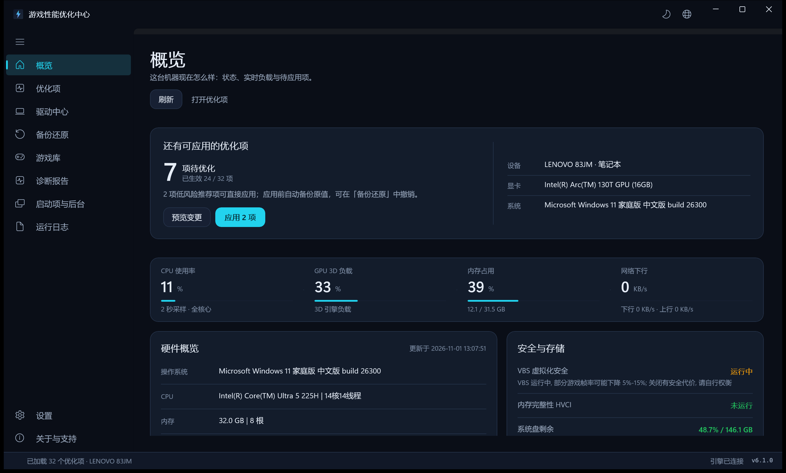
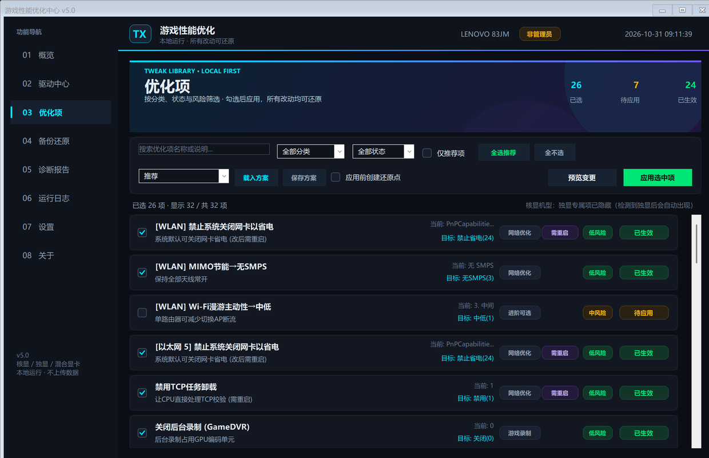
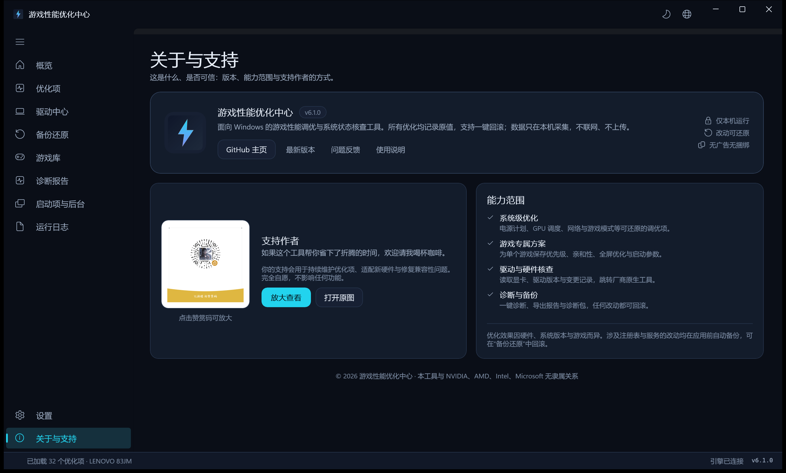

# 游戏性能优化中心

> Windows 10 / 11 上的本地游戏性能优化工具。深色仪表盘界面，所有改动可逆、可还原，不联网、不上传。



## 特点

- **按硬件生成优化项**：核显 / 独显 / 混合显卡自动识别，没有对应硬件或驱动属性的项不会出现，不会强行写入
- **30+ 项可逆优化**：GameDVR / 后台录制、HAGS、可变刷新率、电源计划、CPU 核心停车、网卡省电、PCIe 链路省电、Prefetch、视觉特效等
- **每一步都能还原**：应用前生成 JSON 原值备份 + 按注册表键导出的 `.reg` 快照，支持单项还原、最近一次撤销、全部备份回放
- **只读诊断**：VBS / HVCI、内存 XMP / EXPO、PCIe 链路、NVMe 健康、系统盘空间、电源方案
- **GUI 与 CLI 共用一套引擎**：界面、交互式控制台、命令行参数行为一致
- **本地运行**：不联网、不下载、不上传，设置 / 备份 / 日志都保存在程序目录
- 不修改 Defender、不关闭系统服务、不改 BCD、不超频、不改 DNS / hosts

## 界面

| 优化项 | 关于 |
| --- | --- |
|  |  |

## 快速开始

1. 到 [Releases](../../releases) 下载附件「游戏性能优化中心_v5.0_便携版.zip」（下载文件名为 `game-performance-optimizer_v5.0_portable.zip`），或直接 clone 本仓库
2. 解压到固定文件夹（不要在压缩包里直接双击）
3. 双击 `启动优化脚本.bat`，UAC 提示点“是”
4. 概览页确认硬件 → 优化项页按需勾选 → 预览变更 → 应用选中项
5. 需要撤销时，到“备份还原”页操作

首次打开时优化项会先显示“检测中”，约 1 秒后自动补全真实状态，不需要手动刷新。预览只会列出真正需要变更的项目，已处于推荐值的项不会重复出现。

## 系统要求

- Windows 10 / 11 64 位
- Windows PowerShell 5.1（系统自带）
- 管理员权限
- 建议 1920×1080 及以上分辨率

## 命令行

```powershell
# 交互式控制台
powershell -ExecutionPolicy Bypass -File .\游戏性能优化.ps1

# 导出当前硬件与各项状态（只读）
powershell -ExecutionPolicy Bypass -File .\游戏性能优化.ps1 -Status -OutFile status.json

# 预演推荐项，不写入系统
powershell -ExecutionPolicy Bypass -File .\游戏性能优化.ps1 -DryRun -ApplyRecommended

# 撤销最近一次应用
powershell -ExecutionPolicy Bypass -File .\游戏性能优化.ps1 -RestoreLatest

# 按时间倒序回放全部备份
powershell -ExecutionPolicy Bypass -File .\游戏性能优化.ps1 -RestoreAll
```

常用参数：

| 参数 | 说明 |
| --- | --- |
| `-Status` | 输出状态快照 JSON，可配合 `-OutFile` 写入文件 |
| `-Report` | 导出只读诊断报告 |
| `-DryRun` | 只预览，不写入系统 |
| `-ApplyRecommended` | 选中全部低风险推荐项 |
| `-Profile <名称>` | 载入预设方案 |
| `-RestoreLatest` | 撤销最近一次应用 |
| `-RestoreAll` | 按时间倒序回放全部备份 |
| `-RestorePoint` | 应用前创建系统还原点 |
| `-Yes` | 跳过确认 |
| `-NoElevate` | 不自动提权（只读查询时常用） |

## 项目结构

| 文件 | 作用 |
| --- | --- |
| `游戏性能优化.ps1` | 引擎：优化项定义、状态检查、应用 / 还原、诊断、快照 |
| `游戏性能优化-GUI.ps1` | WinForms 深色界面 |
| `启动优化脚本.bat` | 日常启动器（自动提权） |
| `启动控制台版.bat` | 界面异常时的备用入口 |
| `赞赏码.png` | 支持作者（可选） |
| `使用说明.txt` | 随包分发的说明 |
| `docs/` | README 截图 |
| `LICENSE` | MIT 许可证 |

## 安全与还原

- 每次应用前自动生成 `backups/backup_*.json` 和 `backups/reg_*/` 注册表快照
- 可以在应用前勾选“创建系统还原点”
- 所有改动都记录原值；还原按逆序回放，按位修改的项可精确恢复
- HAGS、DRR、网卡、核显 / 独显等项目需要重启后才能完全生效，列表与结果中会明确标注
- `backups/`、日志和 `gui-settings.json` 属于本机数据，已被 `.gitignore` 排除，请不要公开分享
- GUI 的“导出便携包”会自动排除本机设置、备份和日志

## 兼容性

Intel / NVIDIA / AMD / Qualcomm 显卡；核显、独显、混合显卡自动判定。没有 Wi-Fi 的台式机不会出现无线相关项，纯核显机器不会出现独显项。笔记本电池供电时请谨慎启用“独显常开 / 核心停车”这类会增加功耗的项。

## 常见问题

**杀毒软件报警？**
脚本需要写注册表和电源方案，行为上跟优化工具类似，可能被启发式规则拦截。全部源码都在仓库里，可以逐行查看。

**提示脚本被系统禁止？**
右键 zip → 属性 → 勾选“解除锁定” → 确定，再重新解压。启动器也会自动执行 `Unblock-File`。

**应用之后怎么回退？**
到“备份还原”页，支持单项还原、撤销最近一次、回放全部备份。

**点“预览变更”后提示没有需要变更的项目？**
说明所选项目当前都已处于推荐值，不需要重复应用。

**高缩放屏幕上界面模糊？**
在“设置”页开启实验性高 DPI，然后重启界面。

## English

A local, reversible game performance optimizer for Windows 10/11. It detects the installed GPU / iGPU / dGPU and only offers tweaks that apply to the machine: GameDVR and background recording, HAGS, variable refresh rate, power plans, CPU core parking, NIC power saving, PCIe link power management, Prefetch and visual effects. Every change is backed up as JSON plus a `.reg` snapshot and can be reverted. No telemetry, no downloads, no background service.

Keywords: Windows game optimizer, gaming performance tweaks, FPS and latency, PowerShell GUI, reversible registry tweaks, Intel Arc / NVIDIA / AMD.

## 支持作者

如果这个工具帮到了你，可以扫码请作者喝一杯。完全自愿，不影响任何功能。


## 免责声明

本项目按“现状”提供，不提供任何明示或暗示的担保。修改系统设置存在风险，请先创建还原点并自行评估。因使用本工具造成的任何损失，作者不承担责任。

## 许可证

[MIT](LICENSE)
