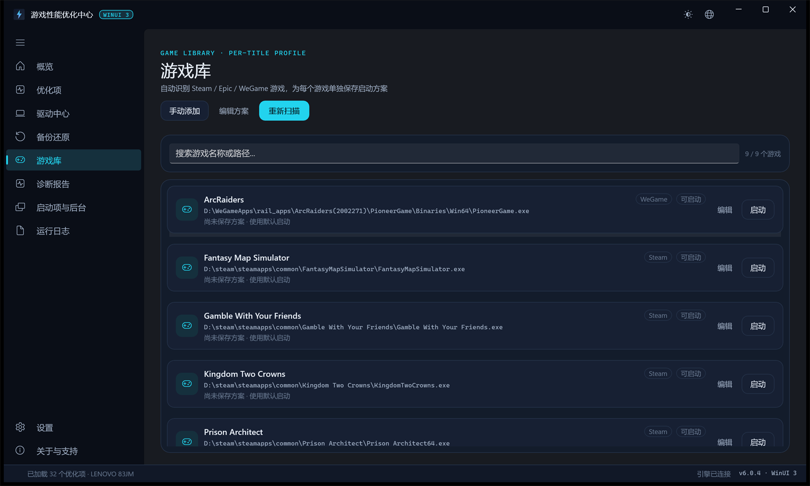

# 游戏性能优化中心

**让 Windows 游戏更稳一点，而不是把系统改乱。**

按本机硬件生成优化项，应用前自动备份原值，每一项都能还原。WinUI 3 原生界面，便携免安装，无遥测、无后台上传。

[**下载最新便携版**](https://github.com/tianxiclaw/game-performance-optimizer/releases/latest) · [使用说明](使用说明.txt) · [问题反馈](https://github.com/tianxiclaw/game-performance-optimizer/issues)

[](LICENSE)
[](#系统要求)
[](https://github.com/tianxiclaw/game-performance-optimizer/releases)


## 它解决什么问题

- **网上教程抄来抄去，改完不知道改了什么。** 这里每个优化项都有当前值、目标值和风险等级，应用前可以完整预览。
- **优化完出问题，不知道怎么退回去。** 每次应用前自动生成 JSON 原值备份和 `.reg` 快照，支持单项还原、撤销最近一次、回放全部备份。
- **不同硬件一刀切。** 核显、独显、混合显卡、有无 Wi-Fi 都会影响可用项，程序只展示真正适用于这台机器的内容。
- **每次启动游戏都要手动设优先级。** 游戏库支持为每个游戏单独保存启动方案，点击启动时自动生效。

## 核心能力

| 能力 | 你能得到什么 |
| --- | --- |
| 硬件感知 | 自动识别 CPU、核显 / 独显 / 混合显卡、内存、网卡、电源方案；不适用的项目不会出现 |
| 30+ 项可逆优化 | GameDVR / 后台录制、HAGS、可变刷新率、电源计划、CPU 核心停车、网卡省电、PCIe 链路省电、Prefetch、视觉特效等 |
| 双备份与回滚 | 应用前生成 `backups/backup_*.json` 与 `backups/reg_*/` 快照；支持单项、最近一次、全部回放 |
| 游戏库 | 自动识别 Steam / Epic / WeGame，也可手动添加任意 exe；每个游戏单独保存优先级、亲和性、全屏优化、高性能 GPU、管理员启动与启动参数 |
| 只读诊断 | VBS / HVCI、内存 XMP / EXPO、PCIe 链路、NVMe 健康、系统盘空间、电源方案；可导出诊断包 |
| GUI 与 CLI 共用引擎 | 图形界面、交互式控制台、命令行参数行为一致，排查问题时可复现同一套逻辑 |

## 界面

优化项页：按分类、状态、风险筛选，勾选后先预览再应用。


游戏库：自动识别常见平台，行内即可编辑并保存单游戏方案。



## 30 秒上手

1. 打开 [Releases](https://github.com/tianxiclaw/game-performance-optimizer/releases/latest)，下载最新的「便携版」zip。
2. 解压到一个固定文件夹，不要在压缩包里直接双击。
3. 双击 `GamePerfCenter.exe`，Windows 弹出管理员权限请求时点“是”。
4. 在“概览”确认硬件，到“优化项”按需勾选，点“预览变更”，确认后再“应用所选”。
5. 需要撤销时，到“备份还原”页还原对应项目或回放备份。

如果原生界面无法启动，可进入 `备用-WinForms` 目录，双击 `启动优化脚本.bat` 使用旧版界面，数据与引擎完全一致。

首次打开时优化项会先显示“检测中”，约 1 秒后自动补全真实状态，不需要手动刷新。预览只会列出真正需要变更的项目，已处于推荐值的项不会重复出现。

## 为什么可以放心用

- **每一项都可回滚。** 应用前自动备份原值；还原按逆序回放，按位修改的项可以精确恢复。
- **不碰高风险区域。** 不修改 Defender、不关闭系统服务、不改 BCD、不超频、不改 DNS / hosts。
- **默认不联网。** 程序不在后台联网、不上传数据；只有你主动点击“检查更新”时才会访问 GitHub Releases。
- **数据留在本地。** 设置、备份、日志都保存在程序目录；便携包不包含作者本机的任何数据。
- **开源可审计。** MIT 许可证，全部引擎与界面源码都在仓库里，可逐行检查。
- **可校验。** 每个便携包内附 `SHA256.txt`，下载后可自行核对。

## 游戏库

- 自动扫描 Steam（`steamapps/appmanifest_*.acf`）、Epic（Manifests）与 WeGame（`WeGameApps/rail_apps`）。
- WeGame 会读取 `rail_game_identify.json` 获取游戏 ID，并从 `Binaries/Win64` 中挑选真正的主程序，排除启动器、反作弊、安装器等。
- 也可以手动添加任意 exe，支持去重、路径校验和移除条目（只删库记录，不删游戏文件）。
- 每个游戏可单独设置：CPU 优先级、核心亲和性、全屏独占、高性能 GPU、管理员启动、启动参数。
- 优先级与亲和性只在“启动游戏”时对本次进程生效，不常驻、不写全局策略。

## 系统要求

| 项目 | 要求 |
| --- | --- |
| 系统 | Windows 10 1809 / 11，64 位 |
| 运行时 | Windows PowerShell 5.1（系统自带，引擎依赖） |
| 权限 | 应用优化项时需要管理员权限；只读查看不需要 |
| 显示 | 建议 1920×1080 及以上；界面会按系统缩放自动适配 |
| 依赖 | 便携版已自包含 .NET 与 Windows App SDK，无需单独安装运行时 |

## 常见问题

**提示“Windows 已保护你的电脑”？**
便携版暂未使用商业代码签名证书，首次运行可能出现 SmartScreen 提示。确认文件来自本仓库 Release、并核对包内 `SHA256.txt` 后，点“更多信息” → “仍要运行”。

**杀毒软件报警？**
脚本需要写注册表和电源方案，行为上跟优化工具类似，可能被启发式规则拦截。全部源码都在仓库里，可以逐行查看；也可以只使用只读诊断功能先验证。

**提示脚本被系统禁止？**
右键 zip → 属性 → 勾选“解除锁定” → 确定，再重新解压。启动器也会自动执行 `Unblock-File`。

**应用之后怎么回退？**
到“备份还原”页，支持单项还原、撤销最近一次、回放全部备份。涉及重启才生效的项目会明确标注。

**点“预览变更”后提示没有需要变更的项目？**
说明所选项目当前都已处于推荐值，不需要重复应用。

**高缩放屏幕上界面模糊？**
WinUI 3 界面会按系统缩放自动适配，无需额外设置；如果异常，请确认显示缩放为整数比例并重启程序。

## 命令行

图形界面与命令行共用同一套引擎，适合批量处理或排查问题。

```powershell
# 交互式控制台
powershell -ExecutionPolicy Bypass -File .\游戏性能优化.ps1

# 导出当前硬件与各项状态（只读）
powershell -ExecutionPolicy Bypass -File .\游戏性能优化.ps1 -Status -OutFile status.json

# 预演推荐项，不写入系统
powershell -ExecutionPolicy Bypass -File .\游戏性能优化.ps1 -DryRun -ApplyRecommended

# 撤销最近一次应用
powershell -ExecutionPolicy Bypass -File .\游戏性能优化.ps1 -RestoreLatest

# 按时间倒序回放全部备份
powershell -ExecutionPolicy Bypass -File .\游戏性能优化.ps1 -RestoreAll
```

常用参数：

| 参数 | 说明 |
| --- | --- |
| `-Status` | 输出状态快照 JSON，可配合 `-OutFile` 写入文件 |
| `-Report` | 导出只读诊断报告 |
| `-DryRun` | 只预览，不写入系统 |
| `-ApplyRecommended` | 选中全部低风险推荐项 |
| `-Profile <名称>` | 载入预设方案 |
| `-RestoreLatest` | 撤销最近一次应用 |
| `-RestoreAll` | 按时间倒序回放全部备份 |
| `-RestorePoint` | 应用前创建系统还原点 |
| `-Yes` | 跳过确认 |
| `-NoElevate` | 不自动提权（只读查询时常用） |

## 项目结构

| 文件 | 作用 |
| --- | --- |
| `src/GamePerfCenter/` | WinUI 3 桌面界面（.NET 10，自包含发布） |
| `src/GamePerfCenter/engine-bridge.ps1` | 界面与 PowerShell 引擎的常驻进程桥 |
| `游戏性能优化.ps1` | 引擎：优化项定义、状态检查、应用 / 还原、诊断、快照 |
| `游戏性能优化-GUI.ps1` | WinForms 旧版界面（便携包内作为备用） |
| `启动优化脚本.bat` | WinForms 备用启动器（自动提权） |
| `启动控制台版.bat` | 控制台入口 |
| `赞赏码.png` | 支持作者（可选） |
| `使用说明.txt` | 随包分发的说明 |
| `docs/` | README 截图 |
| `LICENSE` | MIT 许可证 |

## 兼容性

Intel / NVIDIA / AMD / Qualcomm 显卡；核显、独显、混合显卡自动判定。没有 Wi-Fi 的台式机不会出现无线相关项，纯核显机器不会出现独显项。笔记本电池供电时请谨慎启用“独显常开 / 核心停车”这类会增加功耗的项。

优化效果因硬件、系统版本与游戏而异。涉及注册表或服务的改动都会在应用前备份，可在“备份还原”中回滚。

## English

A local, reversible game performance optimizer for Windows 10/11. It detects the installed GPU / iGPU / dGPU and only offers tweaks that apply to the machine: GameDVR and background recording, HAGS, variable refresh rate, power plans, CPU core parking, NIC power saving, PCIe link power management, Prefetch and visual effects. Every change is backed up as JSON plus a `.reg` snapshot and can be reverted. The game library detects Steam, Epic and WeGame titles and can save a per-title launch profile. No telemetry, no background upload, no background service.

Keywords: Windows game optimizer, gaming performance tweaks, FPS and latency, PowerShell GUI, reversible registry tweaks, Intel Arc / NVIDIA / AMD, WeGame.

## 支持作者

如果这个工具帮你省下了折腾的时间，欢迎扫码请作者喝一杯。完全自愿，不影响任何功能。

点一个 Star、提一个 Issue，或者把项目分享给需要的人，同样是对这个项目最直接的帮助。


## 免责声明

本项目按“现状”提供，不提供任何明示或暗示的担保。修改系统设置存在风险，请先创建还原点并自行评估。因使用本工具造成的任何损失，作者不承担责任。

## 许可证

[MIT](LICENSE)
